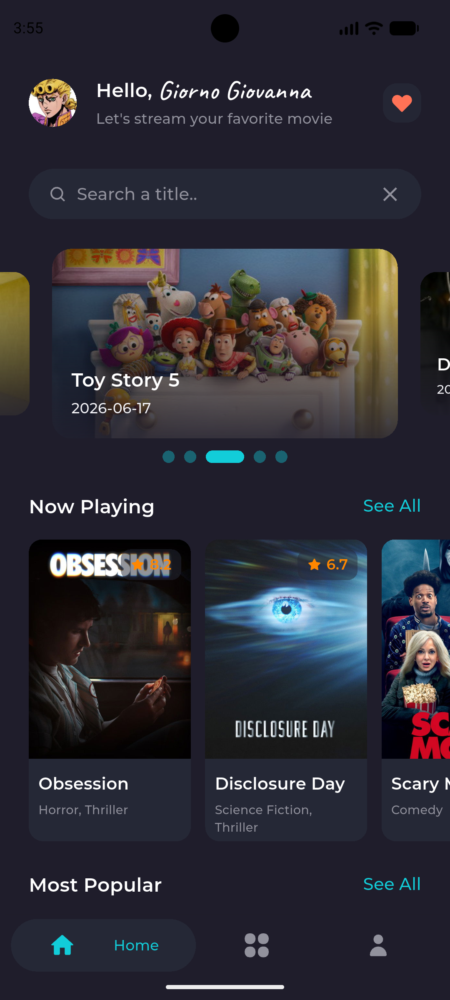
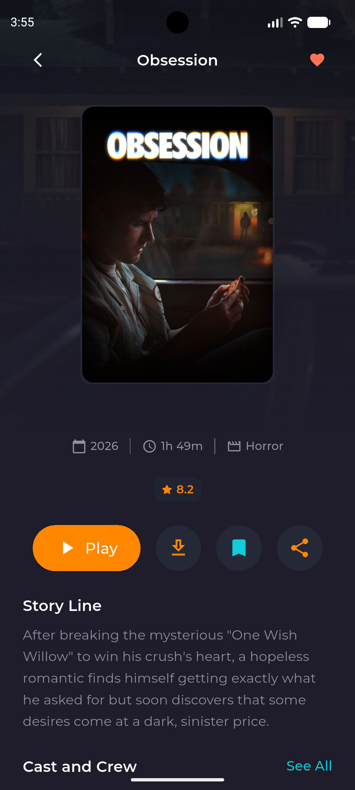
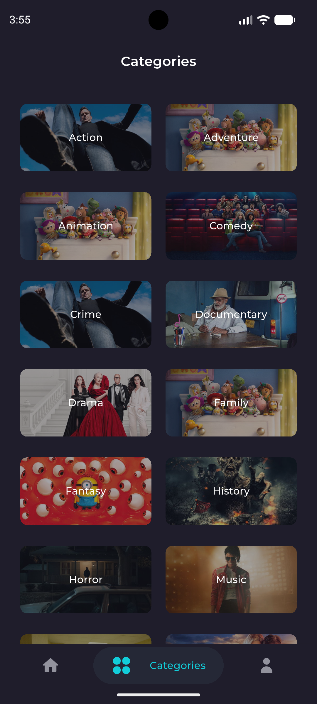
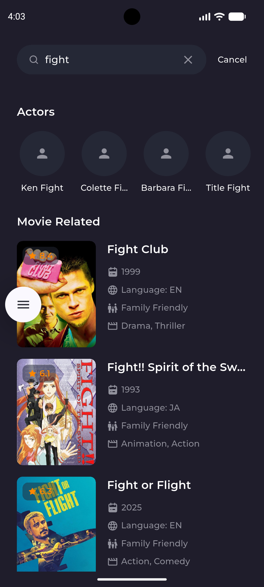
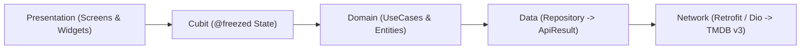

<div align="center">
  

  # Movie Hunter

  *A TMDB movie discovery client built to practice production Flutter architecture — because another movie app only earns its keep if the internals are worth reading.*

  [](https://flutter.dev/)
  [](https://dart.dev/)
  [](https://pub.dev/packages/flutter_bloc)
  [](https://developer.themoviedb.org/docs)
  [](https://github.com/BlueEye2077/movie-hunter/actions/workflows/android_fastlane_firebase_app_distribution_workflow.yml)
  [](LICENSE)

  <p>
    <a href="#demo--walkthrough">Demo</a> ·
    <a href="#features">Features</a> ·
    <a href="#getting-started">Getting Started</a> ·
    <a href="#architecture">Architecture</a> ·
    <a href="#decisions--dead-ends">Decisions &amp; Dead Ends</a> ·
    <a href="#ai-assisted-workflow">AI Workflow</a>
  </p>
</div>

## About

Movie Hunter lets users browse TMDB movies, launch trailers, explore cast and crew filmographies, and sync favorites and watchlists to a TMDB account. It was built as a learning project to practice Clean Architecture boundaries, state-management trade-offs, and debugging real async and lifecycle bugs in Flutter — from refactoring a coupled initial build into layered features to diagnosing what broke along the way.

Start with [Decisions & Dead Ends](#decisions--dead-ends) for the engineering story, or [lib/core/networking](lib/core/networking) and [lib/features/account](lib/features/account) for the implementation.

## Demo & Walkthrough

Try the interactive web emulator (built from the [`feat/cross-platform-network-images`](https://github.com/BlueEye2077/movie-hunter/tree/feat/cross-platform-network-images) branch; `main` only includes the mobile flavor entry points) and watch the full walkthrough video on the portfolio demo page:

<p align="center">
  <a href="https://ahmedbadawy.vercel.app/projects/movie-hunter" target="_blank" rel="noopener noreferrer">
    
  </a>
</p>

<div align="center">

https://github.com/user-attachments/assets/3fb96b0b-4d65-49a6-8873-3ffdecf56488

</div>

| Home | Movie Details | Categories | Search |
| :---: | :---: | :---: | :---: |
|  |  |  |  |

## Features

| Feature | Highlights |
|---|---|
| **Home Discovery Feed** | Upcoming-movies carousel alongside Now Playing, Most Popular, and Top Rated rails with resolved genre tags. |
| **Paginated Movie Browser** | Shared grid/list browser with infinite scroll, duplicate filtering, and view switching that preserves scroll position. |
| **Categories Grid** | TMDB genre grid with backdrop previews fetched in concurrent batches of 4 and cached in memory. |
| **Debounced Search** | Simultaneous movie and person search with a 400 ms debounce and stale-response guards on rapid typing. |
| **Movie Details & Trailers** | Metadata, cast and grouped/deduplicated crew lists, similar movies, native link sharing, and YouTube trailer launch (*Official Trailer → Trailer → Official Teaser*). |
| **Person Details** | Biographies, computed age or deceased status, and "Known For" filmography merged across both cast and crew credits. |
| **TMDB Session Auth** | 3-step login handshake with encrypted session storage, password-manager autofill, and external TMDB registration/reset links. |
| **Profile, Favorites & Watchlist** | Optimistic favorite and watchlist toggles with rollback on API failure, synced across Profile and paginated lists via a broadcast stream. |
| **Onboarding & Startup Routing** | 3-slide first-launch walkthrough that routes subsequent startups directly to Login or Main based on persisted session state. |

## Getting Started

### Prerequisites

- **Flutter SDK** `>=3.47.0` (**Dart** `^3.13.0`)
- **Android device or emulator** (iOS is untested and iOS flavor schemes are not configured)
- A [TMDB account](https://www.themoviedb.org/settings/api) and an **API Read Access Token (v4 Bearer token)**

> [!IMPORTANT]
> `DioFactory` sends `.env`'s `TMDB_API_KEY` value verbatim as the `Authorization` header — use your **v4 Read Access Token** prefixed with `Bearer `, not a raw v3 API key (which fails with `401`).

### Installation

1. Clone the repository:
   ```bash
   git clone https://github.com/BlueEye2077/movie-hunter.git
   cd movie-hunter
   ```

2. Install dependencies:
   ```bash
   flutter pub get
   ```

3. Create a `.env` file in the project root with your TMDB v4 Read Access Token prefixed with `Bearer `:
   ```env
   TMDB_API_KEY="Bearer your_tmdb_v4_read_access_token"
   ```

4. Run code generation for `envied`, `freezed`, `json_serializable`, and `retrofit` (this generates the untracked `lib/core/env/env.g.dart` file):
   ```bash
   dart run build_runner build --delete-conflicting-outputs
   ```

5. Run the app using one of the configured flavors (`development` is set as `default-flavor` in `pubspec.yaml`; matching VS Code launch configurations are included in `.vscode/launch.json`):
   ```bash
   # Development flavor (installs as com.example.movie_hunter.dev)
   flutter run --flavor development -t lib/main_development.dart

   # Production flavor (installs as com.example.movie_hunter)
   flutter run --flavor production -t lib/main_production.dart
   ```

## Architecture

The codebase follows **Feature-First Clean Architecture** (`presentation` → `domain` → `data`). Seven of the nine features contain all three layers; `all_movies` contains only `domain` and `presentation` (it paginates over the home and categories repositories), and `onboarding` is `presentation`-only.



```text
lib/
├── core/
│   ├── common/                 # Shared UI (movie browser scaffold, cards, shimmers, retry/empty views)
│   ├── constants/              # App-wide constants and Hero tag builders
│   ├── di/                     # get_it service locator registration
│   ├── domain/                 # Shared pure-Dart domain types (MovieEntity, PaginatedList<T>)
│   ├── env/                    # Compile-time .env variable definitions (Env)
│   ├── genres/                 # Shared genres module (data, domain, in-memory cache, helper)
│   ├── helpers/                # Secure storage, SharedPreferences, and URL launcher helpers
│   ├── models/                 # Shared data DTOs (Movie, Genre) with inline entity mappers
│   ├── networking/             # Dio factory, API constants, ApiResponse<T>, ApiResult<T>, NetworkExceptions
│   ├── routing/                # Route name constants and AppRouter
│   └── theming/                # Colors, typography, spacing, strings, assets, and theme data
├── features/
│   ├── account/                # Profile, Favorites & Watchlist (data, domain, presentation)
│   ├── all_movies/             # Paginated grid/list movie browser (domain, presentation)
│   ├── auth/                   # TMDB 3-step session login & sign-up redirect (data, domain, presentation)
│   ├── categories/             # Genre grid with batched backdrop previews (data, domain, presentation)
│   ├── home/                   # Discovery feed: Upcoming, Now Playing, Popular, Top Rated (data, domain, presentation)
│   ├── movie_details/          # Movie metadata, cast/crew, trailers, similar movies (data, domain, presentation)
│   ├── onboarding/             # First-launch 3-slide walkthrough (presentation)
│   ├── person_details/         # Actor/director bio and merged cast+crew filmography (data, domain, presentation)
│   └── search/                 # Debounced movie & person search (data, domain, presentation)
├── main_bottom_nav_bar.dart    # Bottom navigation bar
├── main_development.dart       # Development flavor entry point
├── main_production.dart        # Production flavor entry point
├── main_screen.dart            # Root tab shell with lazy-mounted IndexedStack
└── movie_hunter_app.dart       # Root MaterialApp, ScreenUtilInit, and initial route resolution
```

Conventions followed across features:
- **Domain layer**: `domain/` avoids UI framework (`package:flutter/...`), HTTP, and JSON-serialization packages, holding the business rules (credit grouping/deduplication, trailer ranking, age calculation, and genre enrichment) while referencing `ApiResult<T>` and `NetworkExceptions` from `core/networking/`.
- **Data boundary**: Repositories map DTOs to domain entities, catch `DioException`s at the boundary, and return `ApiResult<T>`.
- **Presentation**: All 18 concrete Cubits are registered as factories in `get_it`, depend only on use cases, guard async emissions with `isClosed`, and emit `@freezed` states.

## Decisions & Dead Ends

1. **Incremental Clean Architecture migration over a rewrite (PRs [#25](https://github.com/BlueEye2077/movie-hunter/pull/25)–[#58](https://github.com/BlueEye2077/movie-hunter/pull/58))**
   Rather than rewriting from scratch, the app was migrated on `dev` across 33 PRs by untangling `core/` first and then converting one feature per PR.
   - **Why:** In the original `ui/` and `logic/` structure, Cubits called repositories directly and JSON models leaked into widgets.

2. **Factory Cubits and singleton cache cleanup on logout (PRs [#28](https://github.com/BlueEye2077/movie-hunter/pull/28), [#30](https://github.com/BlueEye2077/movie-hunter/pull/30), [#47](https://github.com/BlueEye2077/movie-hunter/pull/47))**
   All Cubits are registered as `registerFactory` in `get_it` while repositories stay `lazySingleton`, and logging out revokes the remote TMDB session, wipes secure storage, and nulls the account repository's in-memory cache.
   - **What broke:** When Cubits were singletons and the repository cache wasn't cleared on logout, logging into a second TMDB account still rendered the previous user's profile and threw closed-stream errors on remounted screens.

3. **Deduplicating in-flight `account_id` resolution after login / account switch (PRs [#15](https://github.com/BlueEye2077/movie-hunter/pull/15), [#30](https://github.com/BlueEye2077/movie-hunter/pull/30), [#47](https://github.com/BlueEye2077/movie-hunter/pull/47))**
   The account repository resolves `account_id` lazily and shares a single in-flight `GET /account` `Future` across concurrent callers before dispatching favorite or watchlist requests.
   - **What broke:** TMDB login only returns a `session_id`, so when the Profile tab mounted right after login or switching accounts, the Favorites and Watchlist cubits fired before `GET /account` finished saving `account_id` and failed with false `401 Session Expired` errors.

4. **Domain-layer genre enrichment instead of a root `GenresCubit` (PRs [#19](https://github.com/BlueEye2077/movie-hunter/pull/19), [#22](https://github.com/BlueEye2077/movie-hunter/pull/22), [#37](https://github.com/BlueEye2077/movie-hunter/pull/37), [#53](https://github.com/BlueEye2077/movie-hunter/pull/53))**
   A shared `core/genres/` repository caches the TMDB genre list in memory with in-flight request deduplication so domain use cases attach genre names to `MovieEntity` before emitting to the UI.
   - **What broke:** Providing genres via a global `GenresCubit` forced presentation widgets to resolve genre IDs during `build()`, required `BlocProvider.value` wrappers on 7 routes, and crashed when rapid back-navigation emitted after the cubit closed ([#20](https://github.com/BlueEye2077/movie-hunter/pull/20)).

5. **Pure-Dart `PaginatedList<T>` in the domain layer (PR [#36](https://github.com/BlueEye2077/movie-hunter/pull/36))**
   Repositories convert the `@JsonSerializable` networking wrapper (`ApiResponse<T>`) into a pure-Dart `PaginatedList<T>` at the data boundary instead of passing the DTO wrapper or a plain `List<T>` upwards.
   - **Why:** Passing raw lists into the presentation layer stripped `page` and `totalPages` metadata needed for infinite scroll, while passing `ApiResponse<T>` leaked JSON serialization into domain contracts.

<details>
<summary><strong>Show 6 more architectural decisions &amp; fixes</strong></summary>

6. **Lazy tab mounting and batched category previews (PR [#38](https://github.com/BlueEye2077/movie-hunter/pull/38))**
   `MainScreen` defers building the Categories and Profile tabs inside its `IndexedStack` until first tap, and the Categories use case fetches genre backdrop previews in batches of 4 with a page-1 cache.
   - **Why:** Mounting all three tabs eagerly fired 21 background network requests at launch (19 genre discovery calls plus profile endpoints) before the user ever left the Home tab.

7. **Per-feature `@freezed` states instead of a shared `RequestsState<T>` (PRs [#14](https://github.com/BlueEye2077/movie-hunter/pull/14), [#28](https://github.com/BlueEye2077/movie-hunter/pull/28), [#49](https://github.com/BlueEye2077/movie-hunter/pull/49))**
   Each Cubit defines its own `@freezed` state union tailored to its screen, and the shared generic `RequestsState<T>` was deleted.
   - **Why:** A 4-state generic union (`idle`, `loading`, `success`, `error`) couldn't represent screens that needed to keep existing items visible while a bottom pagination spinner ran or show a non-blocking `SnackBar` on page-2 failure.

8. **Single-source-of-truth pagination state in All Movies (PRs [#11](https://github.com/BlueEye2077/movie-hunter/pull/11), [#48](https://github.com/BlueEye2077/movie-hunter/pull/48))**
   `AllMoviesCubit` owns the master movie list internally and emits 4 states (`idle`, `loading`, `success` with pagination flags, `error`) instead of 7 separate pagination state variants.
   - **Why:** Separating the master `_movies` list from the state variants (with an `_movies.isEmpty` guard on `setInitial`) stopped rebuilds from re-adding initial items and collapsed a 7-branch `when` block down to 4 states.

9. **Reversing inverted `core/` → `features/` imports (PRs [#27](https://github.com/BlueEye2077/movie-hunter/pull/27), [#29](https://github.com/BlueEye2077/movie-hunter/pull/29), [#30](https://github.com/BlueEye2077/movie-hunter/pull/30), [#31](https://github.com/BlueEye2077/movie-hunter/pull/31))**
   Shared movie models, shimmer placeholders, and the grid/list browser scaffold were promoted into `core/` so dependency arrows point one way (`features/` → `core/`).
   - **Why:** Early reuse shortcuts left `core/common/` importing widgets and DTOs from `search`, `all_movies`, and `home`, creating circular dependencies across features.

10. **Cross-screen Favorites & Watchlist sync via a broadcast stream (PRs [#17](https://github.com/BlueEye2077/movie-hunter/pull/17), [#47](https://github.com/BlueEye2077/movie-hunter/pull/47))**
    The account repository broadcasts favorite and watchlist mutations over a `Stream` so list cubits remove items locally in place and silently re-fetch page 1 on additions.
    - **Why:** Toggling a movie on Details needed to update Profile counters and account lists immediately without extra fetches; removals update locally while additions re-fetch page 1 so list order stays aligned with TMDB's server-side pagination.

11. **Upgrading Gradle/AGP/Kotlin instead of CI validation flags (PRs [#59](https://github.com/BlueEye2077/movie-hunter/pull/59), [#61](https://github.com/BlueEye2077/movie-hunter/pull/61), [#63](https://github.com/BlueEye2077/movie-hunter/pull/63))**
    The Android build was upgraded to Gradle 9.5, AGP 9.3.1, Kotlin 2.4.20 (`android.builtInKotlin=true`), and JDK 21 so the GitHub Actions + Fastlane workflow runs cleanly on Flutter `stable`.
    - **What broke:** When `stable` bumped Flutter in CI, its Gradle plugin rejected the repo's older Gradle/AGP versions; two temporary workarounds (`--android-skip-build-dependency-validation` and pinning Flutter `3.47.2`) were used to unblock releases before upgrading the toolchain.

</details>

## AI-Assisted Workflow

- **Human-in-the-loop & Mentor Mode:** Used AI as a sidekick across the project for routine implementation (DTO/`Freezed` boilerplate, repetitive layer migrations, PR summaries), while a custom **Mentor Mode** rule flagged unfamiliar concepts and architectural problems as mine to design, implement, and understand line by line.
- **Rules, subagents & MCP tooling:** Built on a customized workflow (adapted from Omar Ahmed's setup) combining explicit layer-boundary rules, a `build_runner` reminder hook, specialized `code-reviewer` / `debugger` / `git-expert` subagents, **Figma MCP** for UI tokens, and **Dart MCP** (`analyze_files`) for static checks.
- **Keeping the AI in check:** Left unconstrained, the agent occasionally over-engineered stable modules (e.g., trying to refactor `network_exceptions.dart` unnecessarily) or skipped `@freezed` in favor of plain `sealed` classes — which required tightening the project rules and gating PRs on a two-step review (`flutter-code-review` + `code-reviewer`).

## Tech Stack

| Category | Technology |
|---|---|
| **Framework & Language** | Flutter (`>=3.47.0`), Dart (`^3.13.0`) |
| **UI & Design System** | `material_ui`, `cupertino_ui`, `flutter_screenutil`, `google_fonts`, `flutter_svg` |
| **Architecture** | Feature-First Clean Architecture (`presentation` → `domain` → `data`) |
| **State Management** | `flutter_bloc` (Cubit) + `@freezed` immutable states |
| **Dependency Injection** | `get_it` service locator |
| **Networking** | `dio`, `retrofit`, `pretty_dio_logger` |
| **Serialization & Codegen** | `freezed`, `json_serializable`, `retrofit_generator`, `envied_generator`, `build_runner` |
| **Local Storage** | `flutter_secure_storage` (session & account IDs), `shared_preferences` (onboarding flag) |
| **Environment Config** | `envied` (compile-time `.env` reading) |
| **External API** | TMDB (The Movie Database) REST API v3 |
| **CI/CD** | GitHub Actions + Fastlane → Firebase App Distribution (Android) |

## API

Movie Hunter consumes the [TMDB v3 REST API](https://developer.themoviedb.org/docs) for movie lists (`upcoming`, `now_playing`, `popular`, `top_rated`), genre discovery (`/genre/movie/list`, `/discover/movie`), multi-entity search (`/search/multi`), movie details (`/movie/{id}`, `/credits`, `/videos`, `/similar`), person credits (`/person/{id}?append_to_response=movie_credits`), and account actions (`/account`, `/favorite`, `/watchlist`). All requests authenticate via a v4 Read Access Token attached as a default `Authorization: Bearer ...` header in `DioFactory`, while user-specific actions use a `session_id` obtained through TMDB's 3-step `/authentication` flow.

## Known Limitations

- **No automated tests on `main` yet** — unit and widget tests haven't been written.
- **iOS is untested** — iOS app icons (`flutter_launcher_icons`) and native splash assets (`flutter_native_splash`) are generated, but the app has only been built and tested on Android due to developing without a Mac.
- **iOS flavor schemes are not configured** — Android defines `development` and `production` product flavors, while `ios/Runner.xcodeproj` only has the default `Runner` scheme despite `default-flavor: development` in `pubspec.yaml`.
- **Android-only CD with debug signing** — The GitHub Actions + Fastlane pipeline distributes Android APKs only; `android/app/build.gradle.kts` currently signs the `release` build type with the debug signing config and uses the `com.example.movie_hunter` application ID.
- **TMDB account required** — There is no guest or skip-login flow (`MovieHunterApp.getInitialRoute` routes unauthenticated users to `LoginScreen`), and new account registration redirects to `themoviedb.org/signup` because TMDB's API does not provide an in-app sign-up endpoint.
- **English-only UI** — User-facing copy is centralized in `AppStrings`, but `flutter_localizations` and ARB translation files are not configured.
- **No offline mode** — Poster and backdrop images are cached on disk via `cached_network_image_ce`, while API responses (genres, category page 1, account details) are cached in memory for the current session only.
- **External trailer playback** — Trailers launch externally in the YouTube app or browser via `url_launcher` rather than playing inline.

## License

This project is licensed under the MIT License — see the [LICENSE](LICENSE) file for details.

---

Built by **Ahmed Badawy** — [Portfolio](https://ahmedbadawy.vercel.app) · [LinkedIn](https://www.linkedin.com/in/ahmedbadawyx77/)
